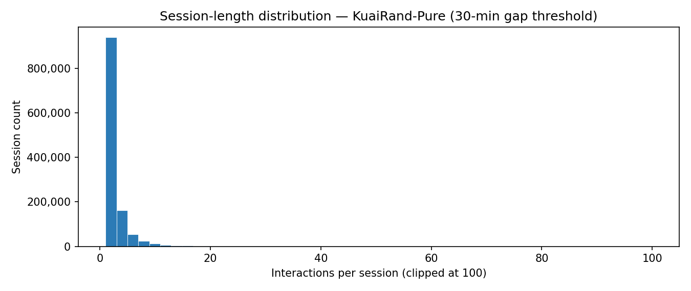
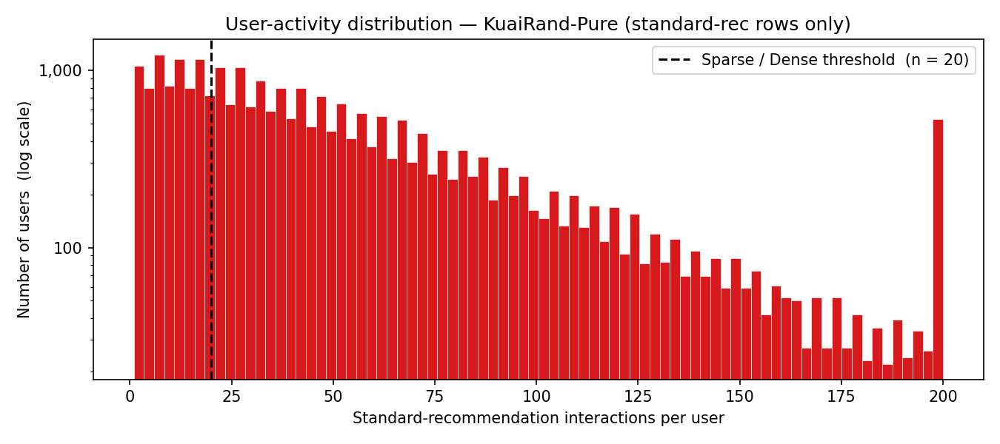
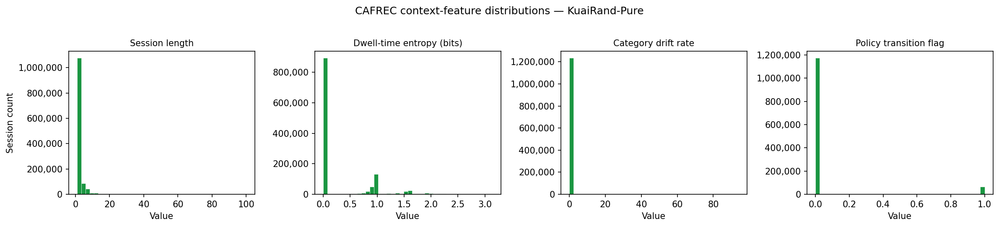

# CAFREC data

**Documentation:** [Project README](../README.md) · [Harness README](../cafrec_harness/README.md) · **Data README** · [H2 runbook](../cafrec_harness/H2_RUNBOOK.md)

This folder holds every dataset file the experiments read. Only this README and `ctx_scaler_params.json` are committed. The data files are large (about 1.3 GB in total) and are released by their owners under their own licence, so they are rebuilt locally from the public sources below.

## Sources

| Source | What it provides | Where to get it |
|---|---|---|
| KuaiRand-Pure (Gao et al., CIKM 2022) | The interaction log: impressions, clicks, play time, video duration and the `is_rand` policy flag | [`KuaiRand-Pure.tar.gz`](https://zenodo.org/records/10439422/files/KuaiRand-Pure.tar.gz) on Zenodo (record 10439422); see also [kuairand.com](https://kuairand.com/) |
| KuaiRand supplementary files | A predicted four-level category hierarchy and the (Chinese) caption of each video | Zenodo record [10.5281/zenodo.18159199](https://zenodo.org/records/18159199) |

KuaiRand is released under CC BY-SA 4.0. User and video identifiers are re-indexed by the publisher, and the study involves no human participants.

After filtering (users with fewer than five organic clicks are removed), KuaiRand-Pure has 651,099 interactions from 22,912 users over 7,210 items. Sessions are cut at a 30-minute inactivity gap, which was fixed before any feature was computed and was not tuned.

## Exploratory figures

The three figures below come from the dataset preparation notebook, [`Foundation/CAFREC_T1_1_KuaiRand_Preparation.ipynb`](../Foundation/CAFREC_T1_1_KuaiRand_Preparation.ipynb). They are stored in [`images/`](../images/).

### Session length



Interactions per session, with the axis clipped at 100. Most sessions hold only a few interactions, and 68.5% of the held-out test interactions open a session.

### User activity



Standard-recommendation interactions per user, on a log scale. The dashed line marks the sparse/dense threshold of 20 interactions from the project plan.

### Context features



Session-level distributions of four context signals: session length, dwell-time entropy, category drift rate and the policy-transition flag. Most sessions sit at a single value of each signal.

## Layout

Once rebuilt, the folder looks like this:

```
data/
  KuaiRand-Pure/                 raw download (extracted tarball)
  recbole/
    kuairand_pure/               kuairand_pure.inter: (user, item, timestamp), used by the baselines
    kuairand_pure_ctx/           kuairand_pure_ctx.inter: the same rows plus the causal context columns
  ctx_scaler_params.json         mean and standard deviation used to z-score the context features
  content_pure/                  category and caption subsets for the Pure items, plus PROVENANCE.json
  profiles/                      frozen long-term user profiles, [n_users, 1024] tensors (*.pt)
  h2/                            prompts and generated profiles for the LLM-profile (H2) experiment
```

## Rebuilding the data

Run these steps in order. All the commands after step 2 run from `cafrec_harness/`.

1. **Download** `KuaiRand-Pure.tar.gz` from the Zenodo link above and extract it to `data/KuaiRand-Pure/`.
2. **Prepare and segment** the log with [`Foundation/CAFREC_T1_1_KuaiRand_Preparation.ipynb`](../Foundation/CAFREC_T1_1_KuaiRand_Preparation.ipynb), then build the RecBole file with [`Foundation/CAFREC_Dataset_Builder_KuaiRand_inter.ipynb`](../Foundation/CAFREC_Dataset_Builder_KuaiRand_inter.ipynb). This writes `recbole/kuairand_pure/kuairand_pure.inter`.
3. **Add the context features:**

   ```bash
   python -m cafrec.features.build_context_inter --tier light
   ```

   This writes `recbole/kuairand_pure_ctx/kuairand_pure_ctx.inter` and `ctx_scaler_params.json`. Each feature is computed causally, from the session history before the row only. `tests/test_features.py` checks this.
4. **Category and caption subsets** (needed for the content profiles, ILD and H2 only): `modal_content_fetch.py` downloads the supplementary files on Modal and checks their MD5 sums, and `audit_content_data.py` writes the Pure subsets to `content_pure/`.
5. **Profiles** (needed only for the profile experiments): `cafrec.features.build_profiles` renders each user's training history as text and embeds it. Run locally with `--backend hashing` it builds the hashing control. The templated bge-large profile uses the same module on a Modal GPU, through `modal_profiles.py`. `build_content_profiles.py` builds the content-bearing profiles. The LLM-generated profile is produced on Modal by `build_h2_prompts.py`, `modal_h2_generate.py` and `modal_h2_embed.py`, as described in the [H2 runbook](../cafrec_harness/H2_RUNBOOK.md).

The baselines and the main CAFREC comparison need only steps 1 to 3.
